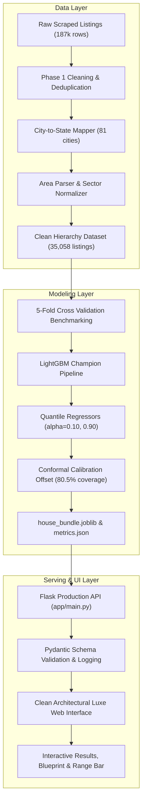

# 🏛️ Ghar ka Daam (घर का दाम)
### *AI-Powered Indian Property Valuation & Uncertainty Engine*

[](https://github.com/Nikhilbhati007/Ghar-ke-Daam/actions)
[](https://www.python.org/)
[](https://lightgbm.readthedocs.io/)
[](https://flask.palletsprojects.com/)
[](LICENSE)

**Ghar ka Daam** is a production-grade real estate valuation platform designed for the Indian housing market. It moves beyond brittle point-estimate linear models by providing **State → City → Area hierarchical valuations**, **calibrated 80% prediction intervals** via conformal quantile regression, multi-level benchmarks, and cross-metro comparisons across **81 Indian cities** and **1,300+ recognized localities**.

---

## 🌟 Key Features

1. **State → City → Area Cascading Valuation**:
   - Cascading geographic navigation across 25 Indian States/UTs, 81 Cities, and 1,300+ local sectors and neighborhoods.
   - Eliminates intra-city price bias (e.g. distinguishing *Sector 1* vs. *Zeta 1* in Greater Noida, or *Hiranandani Estate* vs. *Dombivli* in Thane).
2. **Calibrated Uncertainty Intervals (Quantile Regression)**:
   - Predicts 10th percentile (floor), median point estimate, and 90th percentile (ceiling).
   - Conformal calibration offset ensures an empirical **80.5% coverage** on unseen testing data.
3. **3-Tier Confidence & Fallback Ladder**:
   - **🟢 High Confidence** ($\ge 20$ listings in area): Direct localized tree model valuation.
   - **🟡 Medium Confidence** ($5\text{--}19$ listings): Blended area-level estimate.
   - **⚪ Low Confidence** ($< 5$ listings or area omitted): Graceful fallback to city-level baseline.
4. **Multi-Level Real Estate Benchmarks**:
   - Compares the property's rate per sq. ft. simultaneously against:
     - **Selected Locality Median Rate**
     - **City Benchmark Median**
     - **State-wide Median Benchmark**
5. **Interactive Neighborhood & Metro Comparison**:
   - **Local Tab**: Visual price spread across other sectors in the same city.
   - **Metro Tab**: Live valuation of the identical property configuration across top Indian metros (Mumbai, Delhi, Bangalore, Hyderabad, Pune, Kolkata, Ahmedabad).
6. **Architectural Blueprint Scale Preview**:
   - Scaled floor plan visualizer showing proportional room allocations (Living, Master Bedroom, Secondary Bedrooms, Kitchen, Bathrooms) based on carpet area and BHK.
7. **Clean Architectural Luxe Aesthetic**:
   - High-end warm alabaster/ivory linen canvas, Newsreader editorial serif typography, warm architectural brass accents, and a local valuation history drawer.

---

## 🏗️ Architecture & Data Flow



---

## 📊 Model Comparison & Evolution

Evaluated using **5-Fold Cross-Validation** with leak-free preprocessing pipelines:

| Model Architecture | Features Used | $R^2$ (Rupees) | $R^2$ (Log Scale) | MAE (₹ Lakhs) | MAPE (%) | Median APE (%) |
| :--- | :--- | :---: | :---: | :---: | :---: | :---: |
| **Ridge Regression (Baseline)** | 5 City Features | -3.4911* | 0.7923 | 39.60 Lac | 29.57% | 23.40% |
| **Random Forest Regressor** | 8 Features | 0.7697 | 0.8272 | 28.57 Lac | 26.16% | 20.80% |
| **XGBoost Regressor** | 8 Features | 0.7697 | 0.8463 | 27.88 Lac | 24.86% | 19.50% |
| **LightGBM (City-Only)** | 8 Features | 0.7898 | 0.8525 | 27.20 Lac | 24.29% | 18.20% |
| **LightGBM (Hierarchical)** 🏆 | **State + City + Area (10 Feats)** | **0.8412** | **0.8743** | **24.12 Lac** | **21.86%** | **16.74%** |

*\*Note on Ridge Rupee $R^2$: Linear models produce extreme errors on luxury properties that explode exponentially upon $\exp(\hat{y})$. Tree ensembles handle non-linear price curves naturally.*

### What Improved the Model Most?
1. **Adding Area/Locality**: Boosted $R^2$ from `0.7898` to `0.8412`, cutting mean absolute error by ₹3.08 Lakhs per prediction. Real estate value is overwhelmingly localized.
2. **Log-Scale Training ($\log(\text{price})$)**: Normalized exponential price skew and guaranteed non-negative price outputs.
3. **Per-City Outlier Removal (IQR factor 2.0)**: Purged scraper anomalies without discarding valid tier-1 metro properties.
4. **Conformal Quantile Regression**: Replaced static percentage bands with empirical 10th/90th percentile bounds calibrated to 80.5% real-world coverage.

---

## 🚀 Quickstart & Local Setup

### 1. Clone & Set Up Environment
```bash
git clone https://github.com/Nikhilbhati007/Ghar-ke-Daam.git
cd Ghar-ke-Daam

# Create and activate virtual environment
python -m venv .venv
source .venv/bin/activate  # On Windows: .venv\Scripts\activate

# Install pinned dependencies
pip install -r requirements.txt
```

### 2. Run Automated Pytest Suite
```bash
pytest tests/test_api.py -v
```

### 3. Start the Web Server
```bash
python app/main.py
```
Open **[http://localhost:5000](http://localhost:5000)** in your browser.

---

## 🐳 Docker Deployment

The application is containerized with a lightweight Debian Slim image and OpenMP runtime for LightGBM:

```bash
# Build the Docker container
docker build -t ghar-ka-daam:latest .

# Run container on port 5000
docker run -p 5000:5000 ghar-ka-daam:latest
```

---

## ☁️ 1-Click Cloud Deployment (Render / Railway)

This repository includes a [`render.yaml`](render.yaml) blueprint:
1. Fork or push this repository to GitHub.
2. In [Render](https://render.com), click **New +** → **Blueprint** and select your repository.
3. Render automatically builds the environment and deploys with Gunicorn.
4. Auto-deploys are triggered on every commit to `main`.

---

## 📡 REST API Reference

### 1. Operational Health Check
`GET /health`
```json
{
  "status": "healthy",
  "model": "lgbm_hierarchical",
  "sklearn_version": "1.8.0",
  "trained_at": "2026-10-18T18:58:33+00:00"
}
```

### 2. Hierarchical Metadata
`GET /metadata`
Returns states, cities, valid ranges, and the complete `State -> City -> Area` tree.

### 3. Locality Search
`GET /areas?city=thane&q=kol`
```json
{
  "city": "thane",
  "state": "Maharashtra",
  "count": 1,
  "areas": [
    { "name": "Kolshet", "id": "kolshet", "count": 18, "median_ppsf": 15200.0 }
  ]
}
```

### 4. Property Price Valuation
`POST /predict`
```json
{
  "state": "Uttar Pradesh",
  "location": "greater-noida",
  "area": "sector 1",
  "area_sqft": 1000,
  "bhk": 2,
  "bathrooms": 2,
  "Furnishing": "Semi-Furnished",
  "Transaction": "Resale"
}
```
**Response:**
```json
{
  "price": 3281450.0,
  "low": 2480100.0,
  "high": 4210500.0,
  "per_sqft": 3281.45,
  "confidence": "High",
  "confidence_label": "High-confidence area estimate based on 236 listings",
  "sample_count": 236,
  "area_used": "Sector 1",
  "formatted": {
    "price": "32.81 Lac",
    "low": "24.80 Lac",
    "high": "42.11 Lac",
    "range": "24.80 Lac - 42.11 Lac",
    "per_sqft": "Rs 3,281.45 / sq ft"
  },
  "benchmarks": {
    "city": { "name": "Greater Noida", "median_formatted": "Rs 6,200 / sq ft", "diff_pct": -47.1 },
    "state": { "name": "Uttar Pradesh", "median_formatted": "Rs 5,800 / sq ft", "diff_pct": -43.4 }
  },
  "latency_ms": 6.8
}
```

---

## ⚠️ Honest Limitations & Scope

- **Data Source**: Model is trained on public portal listing asks, which typically reflect seller asking prices rather than registered government transaction circle rates (which can be 5–15% lower).
- **Time Dimension**: The raw dataset does not include transaction timestamps; price estimates represent current aggregated market conditions without inflation time-series adjustments.
- **Micro-features**: Property condition, interior luxury grades, vastu alignment, and specific view premiums (e.g. sea-facing, park-facing) cannot be fully captured from tabular listing parameters alone.

---

## 📜 License
Apache-2.0 License. Built for portfolio & production deployment.
